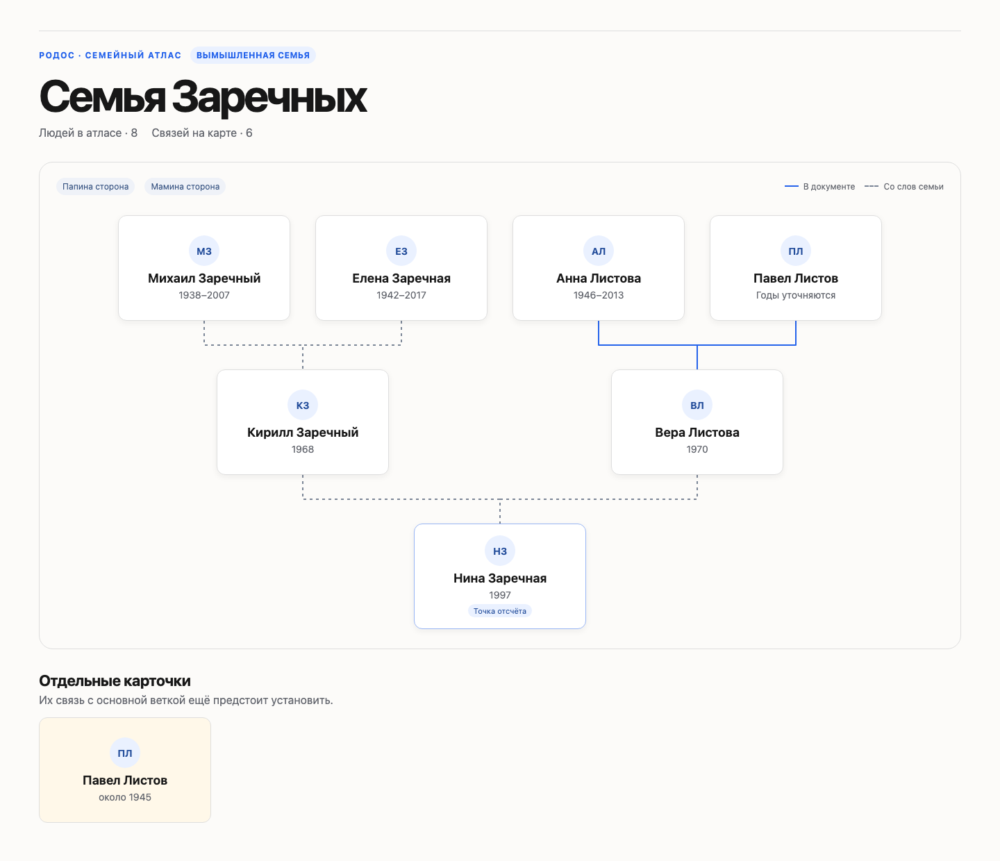

# Родос

Родос — скилл для Claude Code, который помогает собрать семейную историю. Начать можно с одного человека, про которого ты что-то знаешь. Claude задаст несколько вопросов, заведёт карточку и покажет её на карте. Дальше можно добавлять людей, уточнять связи и прикреплять источники.

В репозитории лежат [исходники для Claude Code](.claude/skills/rodos). Для локальной сборки карты нужен Python 3.

Родос вырос из моей работы над семейным деревом и поиском в архивах. Я добавила вопросы для тех, кто начинает собирать родословную, и оформление дерева с карточками.

## Посмотреть пример

В [демо](demo/index.html) вымышленная семья. У Нины есть семейный рассказ о маме и бабушке. Учебная запись о рождении мамы добавляет на карту ещё одну связь, а человек с совпавшим именем остаётся отдельным кандидатом. [Пример первого разговора](demo/session.md)



[Открыть карточку Павла с учебной архивной записью](demo/record.png).

Чтобы посмотреть карту, скачай `demo/index.html` и открой файл в браузере. Он работает локально. Можно также пересобрать её из [данных примера](demo/family.json). Для этого понадобится Python 3.

```sh
python3 .claude/skills/rodos/scripts/build-atlas.py demo/family.json demo/index.html
```

## Запустить у себя

Установи [Claude Code](https://code.claude.com/docs/en/quickstart) и Python 3. В терминале выполни:

```sh
git clone https://github.com/LenaWhynot/rodos.git
cd rodos
claude
```

В открывшемся Claude Code введи `/rodos`. Например:

> Хочу начать с бабушки. Знаю её имя и примерно помню, где она жила.

Claude предложит рабочую папку и спросит, с кого начать, что уже известно и какие материалы есть. Можно рассказать всё словами или указать путь к локальным материалам, которые хочешь использовать. Дальше агент будет уточнять сведения по одной карточке. В рабочей папке появятся `family.json` с данными и `atlas.html` с картой.

Если у тебя уже есть проект Claude Code, скопируй в его `.claude/skills/` всю папку `rodos` из этого репозитория вместе с её файлами. Затем открой Claude Code в своём проекте и вызови `/rodos`. [Документация Claude Code](https://code.claude.com/docs/en/skills#choose-where-skills-load)

Веб-версия Claude принимает пользовательские скиллы в ZIP. Здесь доступен исходник для Claude Code. [Инструкция Claude для веб-версии](https://support.claude.com/en/articles/12512180-use-skills-in-claude)

## Как устроен поиск

По твоей просьбе агент поможет выбрать архив, сверить каталог с записью и сохранить ссылку на источник. Поиск зависит от того, какие сведения уже есть и доступна ли нужная запись. При совпадении имён карточка кандидата остаётся отдельной до сверки. Если доступ закрыт, агент запишет, что удалось проверить и какой следующий шаг возможен.

Храни свои материалы вне публичного репозитория. Папки `local/` и `family-project/` в корне исключены из Git. Для поиска передавай только те сведения, которыми хочешь поделиться, и только в нужном объёме.

## Авторство

Архивная методика основана на [ex-USSR Kinship Research Дениса Ширяева](https://github.com/DenisSergeevitch/ex-ussr-kinship-research), версия 1.37.0, [коммит 84a78bf](https://github.com/DenisSergeevitch/ex-ussr-kinship-research/commit/84a78bf3ac699c4218104760452aaf7b40032e91). Внутри скилла сохранена копия исходников с [лицензией MIT](.claude/skills/rodos/vendor/ex-ussr-kinship-research/LICENSE). В Родос добавлены интервью для старта, карточки и семейный атлас.
